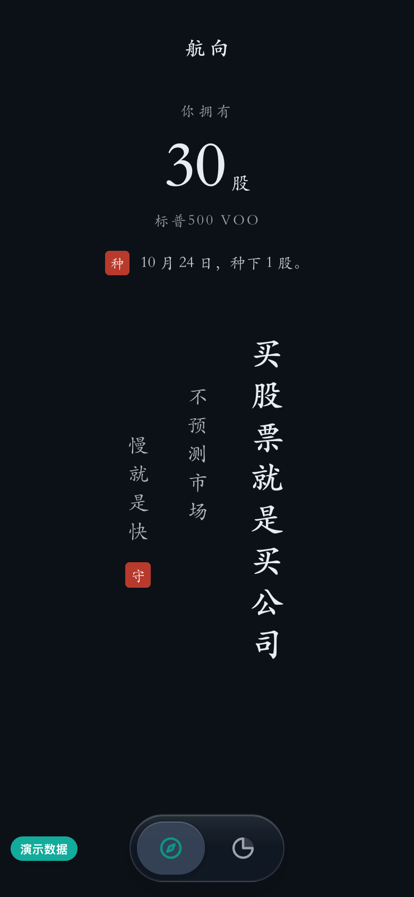
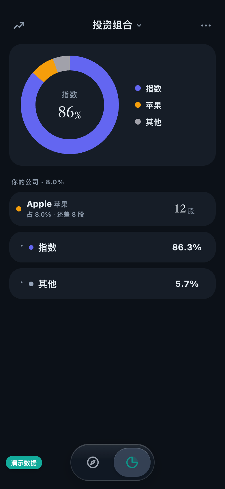
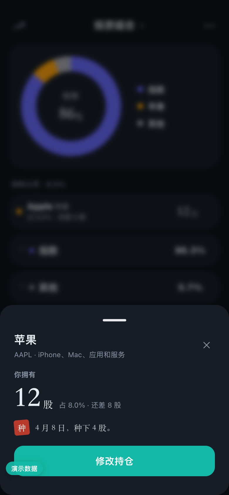
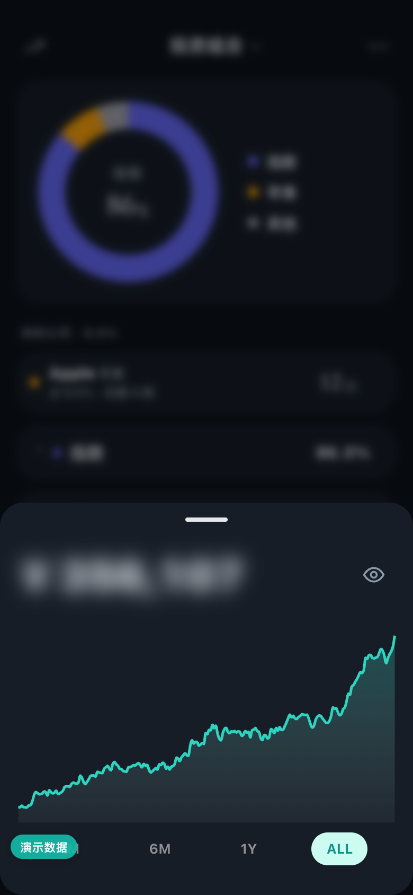
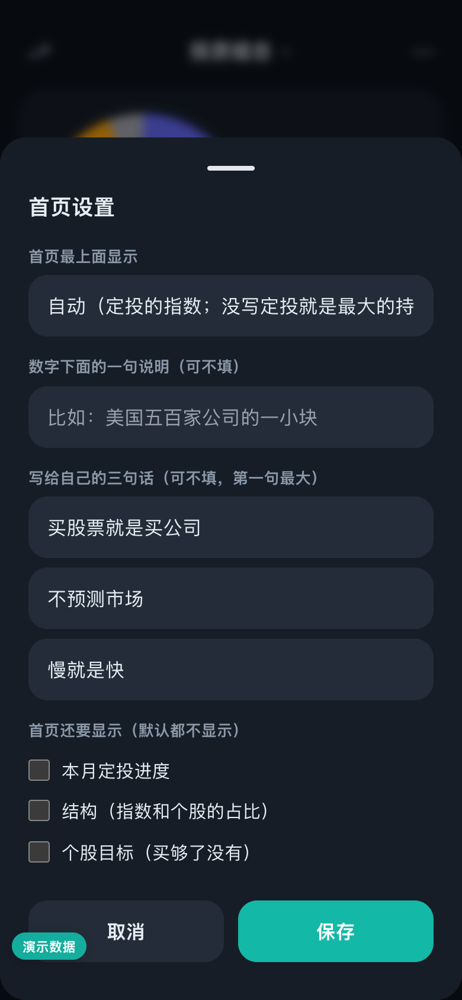
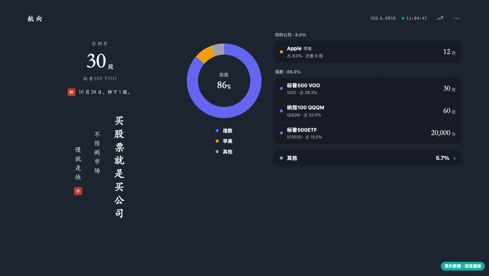

# Ulysses

**Tie yourself to the mast.** A self-hosted portfolio dashboard that holds you to the rules you wrote when you were calm.

[](https://github.com/wangyue168git/ulysses/actions/workflows/ci.yml) [](LICENSE)

[中文](README.md) | English

**[👉 Try it online](https://wangyue168git.github.io/ulysses/)** — nothing to install. It opens with demo data; clear it to enter your own holdings, which stay in your browser only.

> In the *Odyssey*, Ulysses has to sail past the Sirens. Knowing he will not be able to resist their song, he has his crew tie him to the mast and tells them: "Whatever I say later, do not untie me."
>
> Behavioural economists call this a **Ulysses contract**: while you are clear-headed, you bind the impulsive person you will become later.
>
> Investing is the same. You want to chase rallies, run from crashes, and doubt yourself when a friend's stock doubles. This dashboard is the mast: **write down the rule before you buy; from then on every holding carries a small tag that says "add" or "hold off" according to your own rules.**

## Two editions

This repository ships two editions. The idea is the same (write the rule first, then follow it); the interface leans two different ways:

| | **Quiet** (default, branch `quiet`) | **Classic** (branch [`main`](https://github.com/wangyue168git/ulysses/tree/main)) |
|---|---|---|
| For | People who want to look at prices less and hold for the long run | People who want prices, P&L and analysis in one place |
| Home | Only "you own N shares" and three lines you wrote yourself — no prices, no amounts | Total assets, P&L, equity curve, regional split |
| Prices and amounts | Hidden by default; every visit requires a 2-second press on the eye to reveal | Shown; can be masked manually |
| Holdings list | Share counts and weights only | Price, daily change, cost, return |
| Desktop | Read-only: a piece of calligraphy and a holdings table | Look-through, attribution, journal; can add and edit |
| Rules, add/hold-off tags, scorecard, AI advisor, broker sync | Yes | Yes |

If unsure, take the quiet edition: the less often you open the dashboard and the fewer prices you see, the easier it is to stick to the plan. For the classic edition, clone with `-b main`. Both editions read the same data files, so you can switch at any time.

Everything below describes the quiet edition. The interface comes in Chinese and English: it follows your browser language and can be switched from the "⋯" menu. Holding names and your own text are shown as you entered them; AI advisor answers, the year in review and share images are Chinese only for now.

<p>
  
  
  
</p>

## What it does

- **A home screen about direction, not price**: "you own N shares" on top, three lines of your own below. Choose what goes on top — the share count of one holding, total assets (blurred), or nothing — and optionally add this month's index purchase, structure, or stock targets.
- **Prices and amounts are out of sight by default**: hidden on every visit; reveal them from the money sheet with a 2-second press. P&L needs one more tap and hides again after a few seconds. Coming back from the background shows a calm page first.
- **"Add" tags driven by your own rules**: always add, weight-based (add below one line, stop at another, stop once a target share count is reached), or never add. Rules are set on the page and every change is logged. Only "add" is shown in the list; everything else stays quiet.
- **Your companies**: individual stocks get their own group showing the company name, how many shares you own and whether you have bought enough — not tickers and prices.
- **What to buy this month / discipline scorecard / year in review**: tucked into the "⋯" menu on the holdings page. The scorecard grades how well you kept your own rules and contains ratios only, no amounts.
- **Read-only desktop**: the home calligraphy on the left, holdings on the right. All edits happen on the phone, so you don't rebalance just because you are sitting at a computer.
- **Browser extension (optional)**: a small toolbar popup in a sci-fi "bridge readout" style — share counts only, amounts locked, read-only. See [Browser extension](docs/extension.md) (Chinese).
- **All accounts in one place**: China A-shares, mutual funds, Hong Kong and US stocks, and crypto, converted to one currency.
- **AI advisor (optional)**: one-tap check-up, questions, drafting rules for beginners, importing holdings from a screenshot. It can only suggest; every change needs your confirmation and it cannot place orders. By default it is sent ratios, not amounts.
- **Broker sync (optional)**: Interactive Brokers and Longbridge built in; import CSV from others or write a small adapter.
- **Your data stays with you**: one Node.js process and a few JSON files — no database, no third-party account.

<p>
  
  
  
</p>



> All screenshots show fictional demo data.

## Quick start

**Try it first:** open the [browser version](https://wangyue168git.github.io/ulysses/). No deployment: holdings, rules, the discipline page, live quotes and the AI demo all work, with data kept in your own browser (you can export a backup). Broker sync, a real AI model and sharing data across devices need the full self-hosted version below.

With Docker:

```bash
git clone https://github.com/wangyue168git/ulysses.git          # quiet edition (default)
# git clone -b main https://github.com/wangyue168git/ulysses.git  # classic edition
cd ulysses
cp .env.example .env        # edit as needed, e.g. set APP_PASSWORD
docker compose up -d
docker compose logs         # without APP_PASSWORD, the generated first-run password is printed here
```

Open `http://<your-server>:3457` and log in. A "Getting started" card walks you through adding holdings, writing your buying rules and installing it on your phone's home screen.

Or run it directly with Node.js 18+, starting with demo data:

```bash
npm ci
DEMO=1 node server.js
```

In demo mode the **AI advisor demo** works without any model or API key: check-up, rule drafting and screenshot import are all clickable, with pre-written answers based on the demo holdings.

Or deploy to a cloud platform in one click:

[](https://render.com/deploy?repo=https://github.com/wangyue168git/ulysses)

For Fly.io, Railway and other options, see the [deployment guide](docs/deploy.md).

## How to use it

### First visit

1. **Sign in**: open `http://<your-server>:3457` and enter the password. Phones land on the mobile page, computers on the desktop page.
2. **Follow the "Get started" card** on the home screen (it disappears once done):
   - **Enter your holdings**: holdings page, "⋯ → Add holding"; pick a type (US stock / China A-share / fund / crypto), then symbol, quantity and cost. Skip this if you use broker sync — see [Broker sync](docs/brokers/).
   - **Write a buying rule**: the add/edit sheet has a "buying rule" section. No rule means "hold off"; with a rule, the holding is tagged "add" when your rule says so.
   - **Add to your home screen**: use your phone browser's "Add to Home Screen" and open it like an app.
3. **Set up the home screen**: "⋯ → Home settings" — choose which holding's share count goes on top and write your own three lines.

### Writing rules

Each holding takes one kind of rule:

| Rule | Tagged "add" when | Good for |
|---|---|---|
| Always add | Always | An index fund you plan to keep buying |
| By weight | Its weight is below your line; it stops at your cap, or once a target share count is reached | A stock you want to build to a set size and then leave alone |
| Never add | Never | Holdings you do not intend to add to |

Holdings without a rule are treated as "hold off". To buy something not on the list, write the rule first, then buy. Every rule change is logged. Monthly index plans, structure targets and ETF premium rules are covered in [Rules](docs/rules.md).

### Day to day

- **The home screen is enough**: how many shares you own, when you last planted, and your three lines.
- **Structure**: the holdings page. The donut's centre shows the index share; below, holdings are grouped into your companies / index / other, with share counts and weights. "Add" marks what your rules currently allow.
- **One holding**: tap its row. You see shares, weight, whether you have bought enough, and the last purchase date.
- **Amounts**: the chart icon at the top left of the holdings page. Amounts are blurred; press and hold the eye for 2 seconds to reveal them. Only then do prices and cost appear in a holding's detail.
- **Profit and loss**: with the eye open, tap the "updated at" line under the amount. It hides again after a few seconds.
- **Coming back**: after more than a minute away you first see a calm page; tap to enter. Amounts are hidden again.

### When you have money to invest

"⋯ → What to buy this month": enter the amount and it splits it by your rules — index plan first, then structure, then stocks tagged "add". It only does arithmetic on your rules; it does not predict anything. Update the quantities afterwards (or wait for broker sync).

### When you want to change a rule

Tap the holding → "Edit" → change the buying rule and write one line of reason. Consider waiting a few days: the urge to change a rule is strongest exactly when the rule is doing its job.

### Looking back

"⋯ → Discipline scorecard" grades how well you kept your own rules; "Year in review" walks you through the year each December. Both can be saved as images containing ratios only.

### On a computer

The desktop page is read-only: the home calligraphy on the left, the donut and holdings on the right; the chart icon opens the money panel and clicking a row opens its detail. All edits happen on the phone.

### Browser extension

For a quick glance on a computer, load the extension from this repository: `chrome://extensions` → Developer mode → Load unpacked → choose the `extension` folder, then enter your dashboard address and password. It is read-only and shows share counts and weights; amounts unlock after a 2-second press. Its labels follow your browser language. Details: [Browser extension](docs/extension.md) (Chinese).

### Backups

Everything lives in a few JSON files in the data directory (`data/` by default). Copy that directory to back up. See [Security and data](docs/security.md).

## Documentation

The detailed guides are in Chinese for now.

| Topic | Guide |
|---|---|
| The quiet edition: pages, home settings, differences from classic | [Quiet edition](docs/quiet.md) (Chinese) |
| The browser extension: install, what it shows, permissions | [Browser extension](docs/extension.md) (Chinese) |
| What each page does; setting rules in the UI | [docs/features.md](docs/features.md) |
| Writing the rules file `plan.json` | [docs/rules.md](docs/rules.md) |
| AI advisor: features, configuration, privacy | [docs/ai.md](docs/ai.md) |
| Docker, cloud platforms, Node.js | [docs/deploy.md](docs/deploy.md) |
| Broker sync: IB, Longbridge, CSV, Futu, custom adapters | [docs/brokers/](docs/brokers/) |
| Login, backups, market data sources | [docs/security.md](docs/security.md) |

## Disclaimer

This is a bookkeeping and reminder tool. The "add / hold off" tags are a mechanical comparison against **rules you wrote yourself**, and the AI advisor's output is for reference only. Nothing here is investment advice. You are responsible for your own decisions.

## Development and license

```bash
npm test
```

[MIT](LICENSE). Built with [Chart.js](https://www.chartjs.org/), [Tailwind CSS](https://tailwindcss.com/), [ws](https://github.com/websockets/ws) and the [Anthropic SDK](https://github.com/anthropics/anthropic-sdk-typescript) (all MIT).
