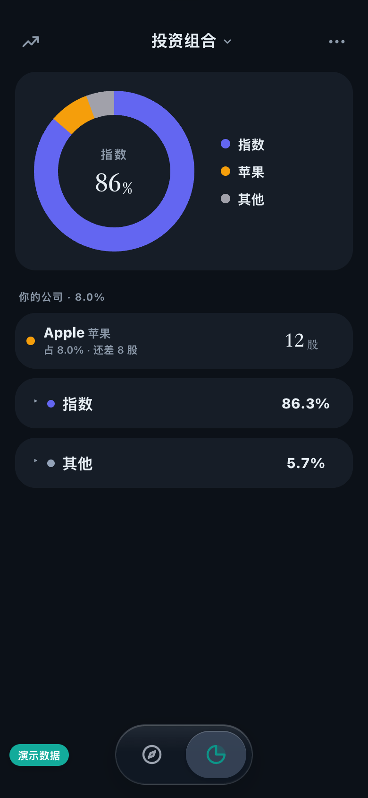
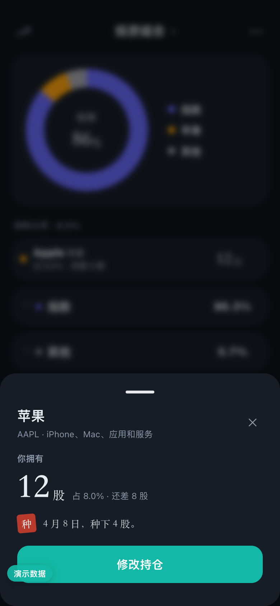
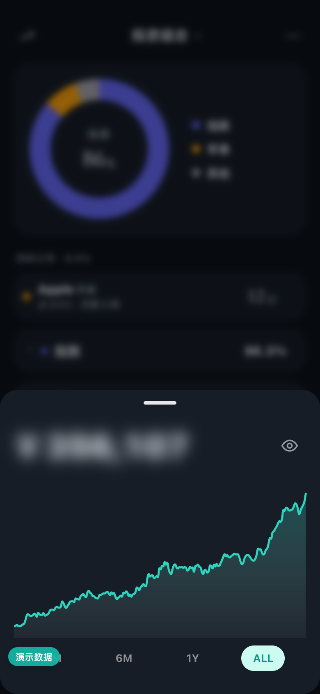
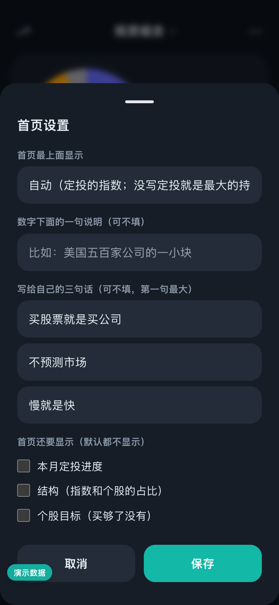
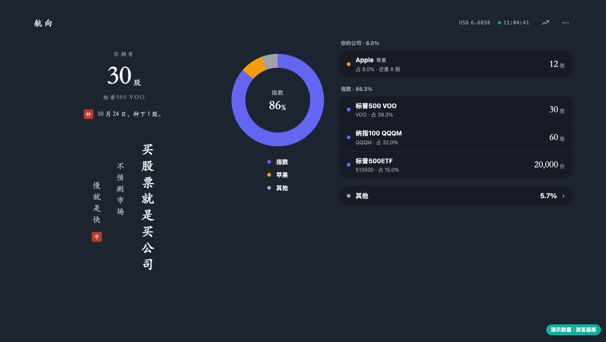

# Ulysses · 尤利西斯

**把自己绑在桅杆上。** 一个自己部署的持仓看板：冷静时写下规则，冲动时替你守住。

[](https://github.com/wangyue168git/ulysses/actions/workflows/ci.yml) [](LICENSE)

中文 | [English](README.en.md)

**[👉 在线试用](https://wangyue168git.github.io/ulysses/)**：不用安装，打开就是演示数据；也可以清空后录入自己的持仓，数据只存在你的浏览器里。

> 荷马史诗里，尤利西斯要驶过塞壬的海域。他知道自己一定会被歌声诱惑，于是提前让水手把他绑在桅杆上，并吩咐：「待会儿我怎么喊，都别给我松绑。」
>
> 行为经济学把这叫做**尤利西斯契约**：在清醒的时候，替将来那个会冲动的自己做好约束。
>
> 投资也一样。大涨时想追、大跌时想跑、看到别人翻倍就怀疑自己。这个看板做的就是那根桅杆：**想买什么，先把规则写下来；之后每只持仓旁边都有一个小签，按你自己的规则告诉你「可加」还是「封仓」。**

## 两个版本

这个仓库有两个版本，理念相同（先写规则，再按规则行事），界面取向不同：

| | **安静版**（默认，分支 `quiet`） | **经典版**（分支 [`main`](https://github.com/wangyue168git/ulysses/tree/main)） |
|---|---|---|
| 适合谁 | 想少看价格、长期持有的人 | 想在一处看全价格、盈亏和分析的人 |
| 首页 | 只有「你拥有多少股」和自己写的三句话，没有价格和金额 | 总资产、盈亏、收益曲线、地区分布 |
| 价格和金额 | 默认隐藏；每次打开都要按住眼睛 2 秒才显示 | 直接显示，可以手动遮掩 |
| 持仓列表 | 只写股数和占比 | 价格、涨跌、成本、收益率 |
| 电脑版 | 只看不改：一幅字加一张持仓表 | 组合透视、收益归因、持仓日记，可以新增和修改 |
| 规则、可加/封仓、纪律成绩单、AI 顾问、券商同步 | 都有 | 都有 |

拿不准就用安静版：打开看板的次数越少、看到的价格越少，越容易按计划行事。想要经典版，克隆时加上 `-b main` 即可。两个版本的数据文件通用，可以随时换。

下面的介绍和截图都是安静版。

<p>
  
  
  
</p>

## 它能做什么

- **首页只讲方向**：最上面是「你拥有多少股」，下面是你自己写的三句话。没有价格，没有涨跌。最上面放什么可以自己选：某一只持仓的数量、总资产（模糊）、或者什么都不放；定投进度、结构、个股目标想看的话可以勾上。
- **价格和金额默认看不见**：每次打开都是隐藏的，要进金额面板按住眼睛 2 秒才显示；盈亏还要再点一下才出现，几秒后自动收起。切到后台再回来，先看到的是一页冷静页。
- **按你自己的规则提示「可加」**：一直可加、看占比（低于某线可加、到某线封仓、买够目标股数即封）、一直封仓……规则在页面上就能设，每次修改都留记录。列表里只标出「可加」的，其余不打扰。
- **你的公司**：个股单独成一组，写的是公司名、你有多少股、买够了没有，而不是代码和价格。
- **本月该买什么 / 纪律成绩单 / 年度回顾**：收在持仓页右上角的「⋯」里，需要时再打开。成绩单按你有没有守住自己的规则打等级，里面只有比例，没有金额。
- **电脑版只看不改**：左边是首页那幅字，右边是持仓；所有修改都在手机上做，免得坐在电脑前顺手调仓。
- **多账户汇总**：A 股、场外基金、港股、美股、加密货币放在一起看，自动换算成人民币。
- **AI 顾问（可选）**：一键体检、随时提问、帮新手起草规则、截图识别导入持仓。它只能「提建议」，改什么都要你确认，也没有任何能下单的能力。默认只发比例，不发金额。
- **券商同步（可选）**：内置 Interactive Brokers、长桥；其他券商可以导入 CSV，或写一个小适配器接进来。
- **数据都在你自己手里**：一个 Node.js 进程 + 几个 JSON 文件，没有数据库，没有第三方账号。

<p>
  
  
  
</p>



> 截图里都是虚构的演示数据。

## 快速开始

**先试试：** 打开 [在线试用版](https://wangyue168git.github.io/ulysses/)（安静版）。它是纯浏览器版，不用部署：持仓、规则、纪律页、实时行情、AI 体验版都能用，数据存在你自己的浏览器里，可以导出备份。券商自动同步、真实 AI 顾问、多设备共用需要部署完整版，见 [部署](docs/deploy.md#浏览器版不用部署)。

**部署完整版**，用 Docker：

```bash
git clone https://github.com/wangyue168git/ulysses.git          # 安静版(默认)
# git clone -b main https://github.com/wangyue168git/ulysses.git  # 想要经典版用这一行
cd ulysses
cp .env.example .env        # 按需修改, 比如设置 APP_PASSWORD
docker compose up -d
docker compose logs         # 没设 APP_PASSWORD 时, 这里能看到首次生成的登录密码
```

浏览器打开 `http://<你的服务器>:3457`，输入密码即可。第一次进去会有「开始使用」引导：录入持仓、写下买入规则、装到手机桌面。

或者直接用 Node.js（18 以上），先载入演示数据看看效果：

```bash
npm ci
DEMO=1 node server.js
```

演示模式下，没配模型也能试用 **AI 顾问体验版**：体检、起草规则、截图导入都能点，回答是预置的，数字来自演示持仓。

也可以一键部署到云平台：

[](https://render.com/deploy?repo=https://github.com/wangyue168git/ulysses)

Fly.io、Railway 等其他方式见 [部署说明](docs/deploy.md)。

## 文档

| 想了解 | 看这里 |
|---|---|
| 安静版的页面、首页设置、和经典版的区别 | [安静版说明](docs/quiet.md) |
| 规则、成绩单等功能的细节（按经典版的页面写的，功能两版相同） | [功能详解](docs/features.md) |
| 规则文件 `plan.json` 怎么写 | [配置规则](docs/rules.md) |
| AI 顾问能做什么、怎么配置、隐私 | [AI 顾问](docs/ai.md) |
| Docker、云平台、Node.js 部署 | [部署](docs/deploy.md) |
| 券商同步：IB、长桥、CSV、富途、自己写适配器 | [券商同步](docs/brokers/) |
| 登录与密码、备份、行情数据来源 | [安全与数据](docs/security.md) |

## 免责声明

本项目只是一个记账和提醒工具。页面上的「可加 / 封仓」只是按**你自己写的规则**机械比较的结果，AI 顾问的内容也只是参考，都不构成投资建议。投资有风险，决策请自行负责。

## 开发与许可

```bash
npm test        # 运行测试
```

[MIT](LICENSE) 许可。用到的开源项目：[Chart.js](https://www.chartjs.org/)、[Tailwind CSS](https://tailwindcss.com/)、[ws](https://github.com/websockets/ws)、[Anthropic SDK](https://github.com/anthropics/anthropic-sdk-typescript)（均为 MIT）。
