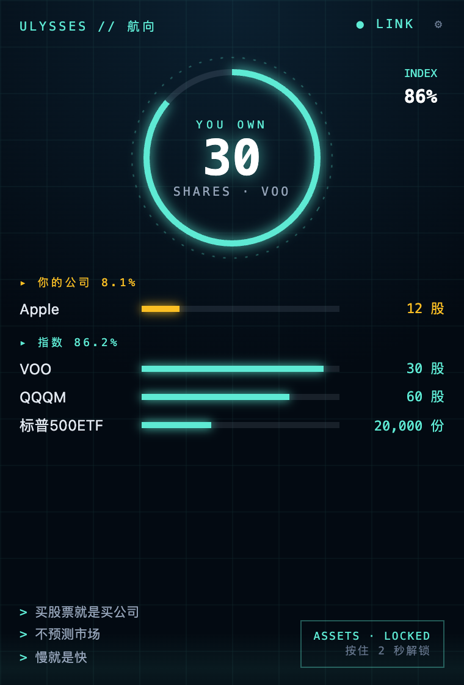
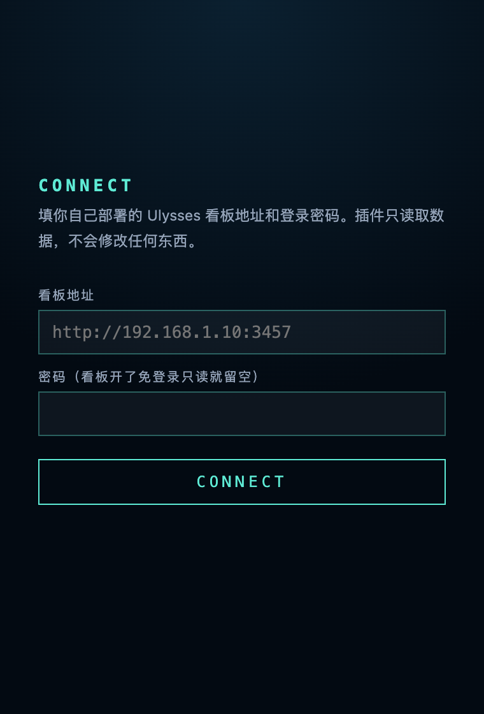

# 浏览器插件

一个只读的小弹窗，画风和看板不同（深蓝底、青色细线的"舰桥读数"），内容守同一条线：先看股数，金额默认上锁。

  
  

## 它显示什么

- **中间的环**：环里是「你拥有多少股」，和首页设置里选的是同一只；环上亮的一段是指数占比。首页设置选的是「总资产」或「不显示」时，环里改为显示指数占比。
- **你的公司 / 指数**：每组最多列 4 只，只写股数，横条长短是占比。
- **左下角**：你写的三句话。
- **右下角**：上锁的金额。按住 2 秒解锁，再点一下重新上锁；关掉弹窗后自动恢复上锁。
- **右上角**：`● LINK` 表示连上了看板；`● OFFLINE` 表示这次没连上，画面是上一次的数据。

没有价格、涨跌和盈亏。

## 安装

插件没有上架商店，从仓库里直接加载：

1. 把仓库克隆或下载到本地（已经部署了看板的话，用同一份代码即可）。
2. 浏览器打开 `chrome://extensions`（Edge 是 `edge://extensions`），打开右上角的「开发者模式」。
3. 点「加载已解压的扩展程序」，选仓库里的 `extension` 文件夹。
4. 点工具栏上的 Ulysses 图标，填**看板地址**（比如 `http://192.168.1.10:3457`，不要带后面的路径）和**登录密码**，点 CONNECT。浏览器会问是否允许访问这个地址，点允许。

看板设了 `PUBLIC_READ=1`（免登录只读）的话，密码留空。

想换地址或重新登录，点弹窗右上角的齿轮。

## 它需要什么

- **一个已部署的看板。** 插件自己不存持仓，每次打开弹窗时向你的看板要一次数据。只在浏览器里用的在线试用版没有服务器，插件连不上。
- **访问你填的那一个地址的权限。** 装的时候不要任何网站权限，填了地址后才申请那一个。
- **本地存储。** 存看板地址、登录令牌，和上一次画面用到的数据（代码、名称、数量、市值；不存价格和交易记录）。

## 它不做什么

- 不在后台运行，不定时抓行情。
- 不发任何修改请求，新增和修改都在手机端做。
- 不把数据发到你的看板以外的任何地方。

## 常见问题

**显示 OFFLINE。** 看板没开，或者当前网络访问不到那个地址（比如看板在家里的内网、你在外面）。

**又让我填密码。** 登录令牌失效了（看板重启或令牌过期），重新填一次即可。

**分组和看板不一样。** 插件自带一份分类规则（`extension/classify.js`，和仓库根目录的是同一份）。更新了看板代码后，在扩展程序页面点一下插件卡片上的刷新。

**加载后扩展程序页面有报错。** 先点「全部清除」，再点刷新，然后打开弹窗看是否还出现。旧的报错会一直留在列表里，不代表现在还在出错。

## 界面语言

跟随浏览器语言：中文环境是中文，其余是英文。持仓名称和你写的三句话保持原样。
